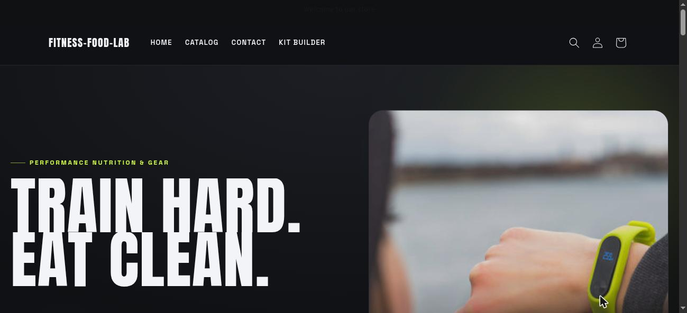
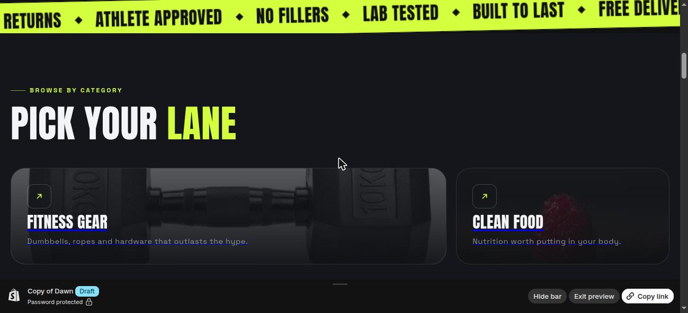
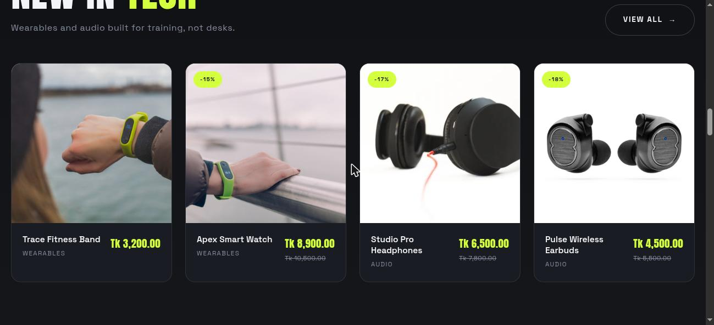
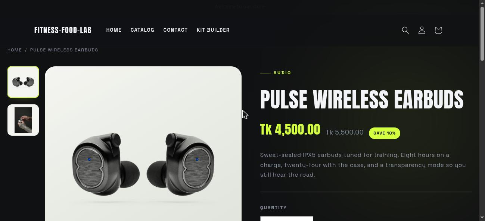

# Fitness Food Lab — Custom Shopify Theme

A dark, high-energy storefront for a fitness gear and nutrition brand. Built on Shopify's Dawn (Online Store 2.0) with a custom design and motion layer written from scratch.

**Live demo:** [fitness-food-lab.myshopify.com](https://fitness-food-lab.myshopify.com) · store password: `123`

> This is a showcase repository. The theme source is private — [get in touch](https://www.fiverr.com/rashed_al_amin) if you'd like something similar built for your store.

---

## Home

Full-bleed hero with a staggered line-by-line text reveal, subtle parallax on the product frame, and an animated scroll cue.

## Categories

A bento-style category grid. Tiles pull their own artwork from the collection, and a soft glow follows the cursor across each card.

## Product grid

Cards lift on hover and cross-fade to a second product photo. Discount badges are calculated from the live compare-at price, so they're never out of date.

## Product page

Custom PDP with a thumbnail rail, hover-to-zoom, pill variant selectors and a sticky add-to-cart bar that slides in once the main buy button scrolls out of view.

---

## What's in the build

**Design system** — Dark palette with an acid-lime accent, Anton display type over Space Grotesk, and a consistent scale applied across every section.

**9 custom sections** — Hero, marquee ticker, category grid, product showcase, count-up stats, sticky split, reviews and closing CTA. All built as Online Store 2.0 sections, so every heading, image and link is editable from the Shopify admin without touching code.

**Motion** — Scroll-triggered reveals, an infinite marquee, animated counters, magnetic buttons and a scroll-progress bar. Written in vanilla JavaScript with no libraries, and it respects the visitor's reduced-motion setting.

**Merchandising** — Automated collections (Fitness Gear, Clothing, Clean Food, Electronics) that populate themselves from the product taxonomy, so new products file themselves into the right category.

**Built on** Shopify Dawn 15.4.1 · Liquid · vanilla JS · CSS

---

## About

Built by **MD Rashed Al Amin** — full-stack engineer working on Shopify, custom storefronts and AI integrations.

[Fiverr](https://www.fiverr.com/rashed_al_amin) · [LinkedIn](https://www.linkedin.com/in/md-rashed-al-amin) · [Portfolio](https://portfolio-lake-eight-b8yon5rijt.vercel.app)
